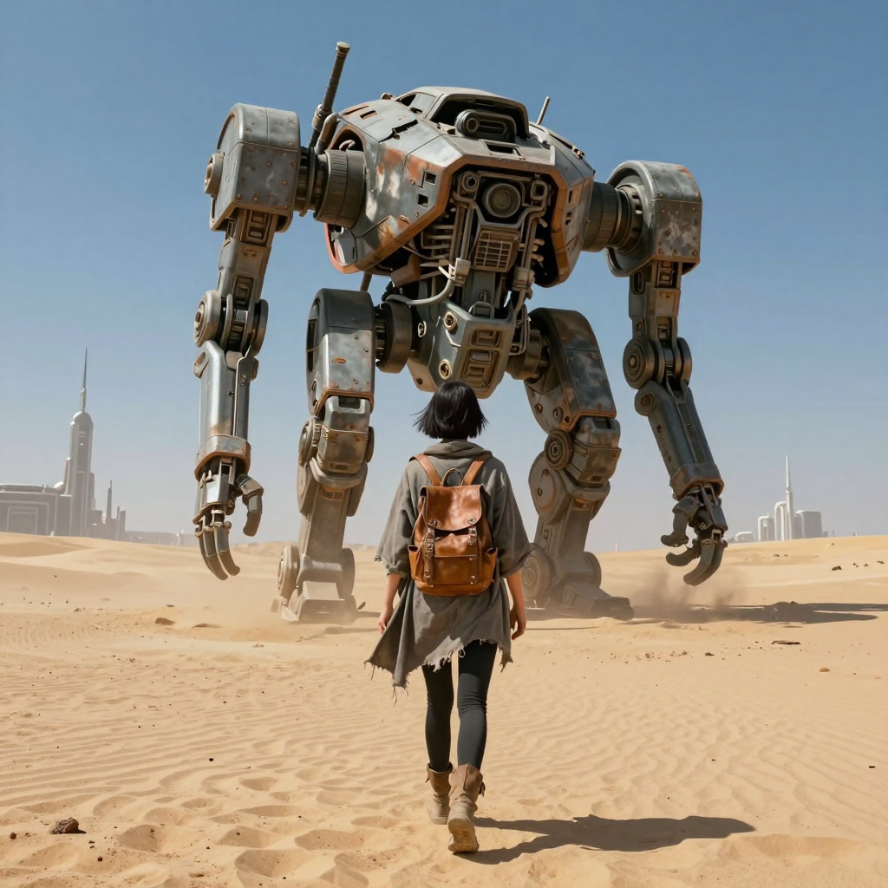
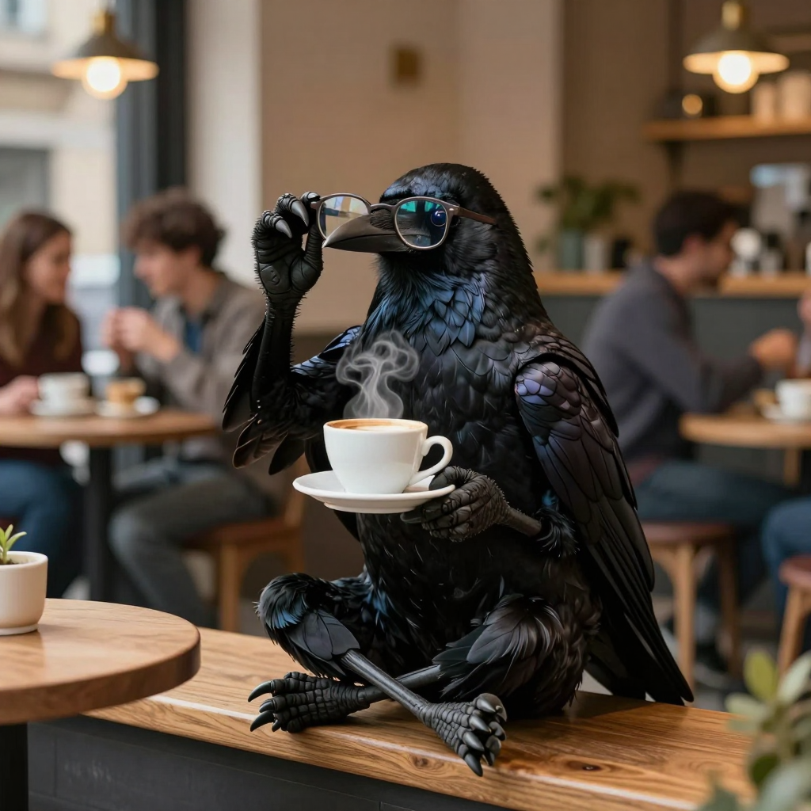
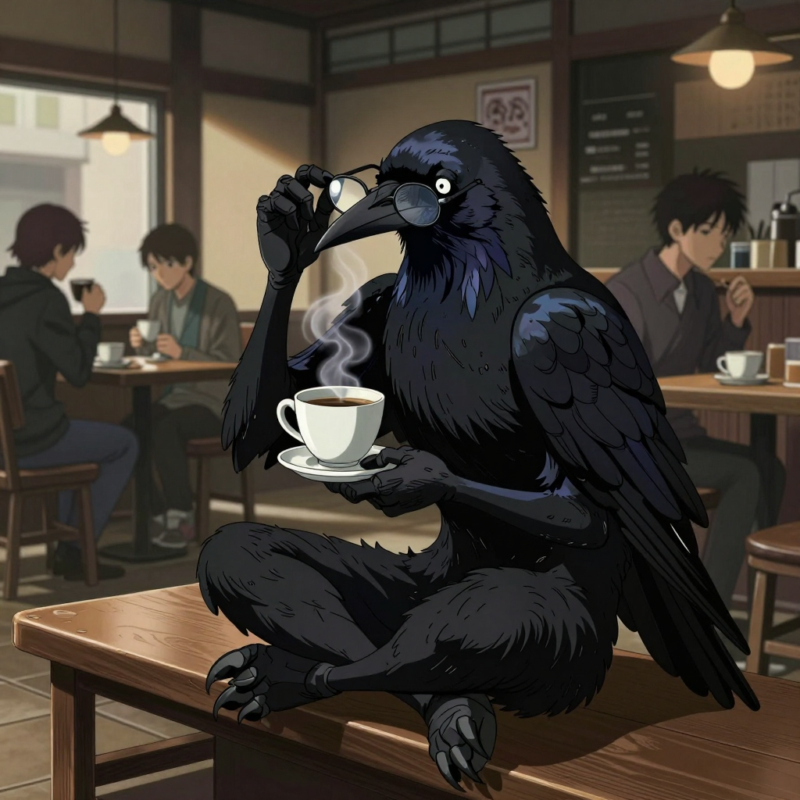

# Benchmarks

Measured on **Windows 11 (`Intel Arc Pro B70`, `xpu:0`, `torch==2.13.0+xpu`)**.
- **Stock ComfyUI (OOTB):** out-of-the-box ComfyUI without `ComfyUI-Intel-Arc-XPU` (`DynamicVRAM` off, stock PyTorch ops).
- **With Extension:** `ComfyUI-Intel-Arc-XPU` (`omni_xpu_kernel==0.2.0b3+torch213.bmg`, `comfy-kitchen-xpu-runtime==0.2.41`, `comfy-aimdo-xpu-runtime==0.6.0`, `--enable-dynamic-vram`), showing both `OMNI_ATTN_BACKEND=torch` and `OMNI_ATTN_BACKEND=cute`.

## Comparison Table

| Model | Config | Stock ComfyUI (OOTB) | With Extension (`torch`) | With Extension (`cute`) | Speedup vs Stock |
| --- | --- | --- | --- | --- | --- |
| **`MOSS-Image`** | `int8_convrot` + `W4A8`, `25` steps | `375.28s` cold · `50.75s` warm | `103.45s` cold · `20.01s` warm | **`29.53s`** cold · **`18.27s`** warm | **`12.7×` cold · `2.78×` warm** (`cute`) |
| **`MiniMax H3 Ref2VA`** | `int8_convrot` + `NVFP4`, `20` steps | `399.91s` cold · `1582.00s` warm | **`209.29s`** cold | — *(8-step ref below)* | **`1.91×` cold** (`torch`) |
| **`Qwen Image 2.1 T2I`** | `int8_convrot`, `1024×1024`, `25` steps | — *(not tested)* | `22.48s` cold · `12.58s` warm | **`21.51s`** cold · **`11.38s`** warm | `1.05×` cold · `1.11×` warm (`cute` vs `torch`) |
| **`Z-Image Turbo`** | `bf16`, `1024×1024`, `8` steps | — *(not tested)* | — | **`33.41s`** cold · **`5.19s`–`5.27s`** warm | — *(reference, `1.71–1.72 it/s`)* |
| **`WAN 2.2 T2V 14B`** | `fp8_scaled`, `2` steps (Turbo) | — *(not tested)* | `104.37s` cold | **`93.09s`** cold · **`82.62s`** warm | `1.12×` cold (`cute` vs `torch`) |
| **`MiniMax H3 Ref2VA` (8-step)** | `8`-step Turbo, `960×544`, `8s` + audio | — *(not tested)* | **`293.36s`** (`fp8_scaled`) · `86.31s` (`int8_convrot` warm) | **`70.88s`** (`int8_convrot` warm) | — *(reference, `0.00 ms` AV drift)* |

## Sample Outputs

- **[`assets/minimax_h3_ref2va_8s_b70.mp4`](./assets/minimax_h3_ref2va_8s_b70.mp4)** (`6.34 MB`, `960×544`, `24 fps`, `8.0s` video + AAC audio, **0.00 ms** AV drift; `293.36s` total: `14.4s` conditioning, `252.5s` sampling, `22.3s` decode, `2.3s` save).
  - Embeds the ComfyUI workflow (with empty `api_key` and no local paths).

### Z-Image Turbo (`1024×1024`, `8` steps `res_multistep / simple`, `cfg=1.0`, `seed=42`, `OMNI_ATTN_BACKEND=cute`)

All three PNGs below embed the full ComfyUI `prompt` and `workflow` metadata (`z_image_turbo_bf16.safetensors`, `qwen_3_4b.safetensors`, `ae.safetensors`) with no local paths or credentials:

| Sample | Run State | Total (`Prompt executed in`) | Sampler Speed | File |
| --- | --- | --- | --- | --- |
| **Desert Mecha** | Cold | `33.41s` | `1.82–1.85 it/s` | [`z_image_turbo_mecha_desert_b70.png`](./assets/z_image_turbo_mecha_desert_b70.png) (`1.27 MB`) |
| **Crow in Café (Digital Painting)** | Warm | `5.27s` | `1.71 it/s` | [`z_image_turbo_crow_cafe_b70.png`](./assets/z_image_turbo_crow_cafe_b70.png) (`1.27 MB`) |
| **Crow in Café (Seinen Anime)** | Warm | `5.19s` | `1.71–1.72 it/s` | [`z_image_turbo_crow_anime_b70.png`](./assets/z_image_turbo_crow_anime_b70.png) (`1.25 MB`) |

Prompts & visual previews (click to expand)

#### 1. Desert Mecha (`z_image_turbo_mecha_desert_b70.png` — `33.41s` cold)

> **Positive:** `A lone figure, likely female, walks away from the viewer across a vast, sandy desert landscape, facing a colossal, dilapidated war machine. The subject is of indeterminable ethnicity, her hair a dark, blunt bob. She wears a tattered gray wrap, a tan leather backpack, black leggings, and worn brown boots. The war machine, a massive bipedal walker, towers behind her, constructed from weathered metal panels, suggesting advanced age and battle damage. Its design features a large cockpit and weaponry. The sky is a clear, bright blue, contrasting sharply with the warm tones of the desert and the cooler grays and browns of the machine and the figure's attire. The background features a distant, futuristic city with tall, spired structures. The composition uses a low-angle perspective, emphasizing the scale of the walker and the vulnerability of the lone figure. The overall mood is one of post-apocalyptic exploration, a sense of solitude, and facing overwhelming odds. The lighting is strong, casting shadows and highlighting the textures. Style reminiscent of Science Fiction concept art, and digital painting.`
>
> **Negative:** `low quality, bad anatomy, extra digits, missing digits, extra limbs, missing limbs`

#### 2. Crow in Café — Digital Painting (`z_image_turbo_crow_cafe_b70.png` — `5.27s` warm)

> **Positive:** `An anthropomorphic crow sits cross-legged on a bench inside a cozy, bustling café, surrounded by other patrons casually enjoying their coffee. The crow is the central subject, rendered with a sleek body covered in deep black feathers with subtle iridescent highlights. Its posture is calm and self-assured, conveying a sense of quiet intelligence and relaxed sophistication. One of its hands is unusually human in structure, but still covered in black feathers, with articulated fingers and a natural anatomy. In one feathered human-like hand, it delicately holds a steaming cup of coffee. With the other, it gently lifts or adjusts a pair of eyeglasses resting on its beak, as if pausing in thought or about to make an observant remark. The crow’s expression is contemplative and subtly stylish, blending avian features with human mannerisms. It sits on a simple wooden bench, legs crossed in a very human pose, enhancing the surreal yet elegant tone of the scene. The café interior is warm and inviting, filled with soft ambient light, wooden furniture, ceramic cups, and blurred figures of other customers chatting or sipping drinks in the background. The surrounding people are dressed casually, contributing to the everyday realism of the environment, while the crow remains the striking focal point. The composition uses a slightly eye-level cinematic perspective, emphasizing the crow’s personality and making the viewer feel as though they are sharing the café space. The color palette combines warm browns, soft creams, and golden café lighting with the rich dark tones of the crow’s feathers, creating visual contrast and atmosphere. The overall mood is whimsical, intelligent, and subtly humorous, with a touch of urban fantasy. The lighting is soft yet directional, highlighting the textures of the feathers, the steam rising from the coffee, and the reflective surface of the glasses. Style reminiscent of highly detailed character-focused digital painting, with elements of surreal realism and cinematic concept art.`
>
> **Negative:** `low quality, bad anatomy, extra digits, missing digits, extra limbs, missing limbs`

#### 3. Crow in Café — Seinen Anime (`z_image_turbo_crow_anime_b70.png` — `5.19s` warm)

> **Positive:** `An anthropomorphic crow sits cross-legged on a wooden bench inside a dimly lit Japanese-style café, surrounded by ordinary people quietly drinking coffee and engaging in conversations. The crow is the central subject, illustrated in a dark, psychological anime aesthetic reminiscent of *Death Note*, featuring sharp linework, dramatic shadows, intricate details, and a mysterious atmosphere. Its sleek black feathers have subtle blue and violet highlights, contrasting with its piercing, intelligent eyes and long, sharply defined beak. Its body combines realistic avian anatomy with elegant human-like proportions, creating a sophisticated and slightly unsettling character. Both hands have anatomically human shapes with five articulated fingers, but are entirely covered in fine black feathers, seamlessly blending with its avian appearance. In one hand, the crow delicately holds a small porcelain cup of steaming black coffee, while the other hand adjusts a pair of thin-framed glasses resting on its face, conveying an expression of calculated intelligence and deep contemplation. Its legs are crossed naturally in a relaxed yet commanding posture, as though silently analyzing everyone around it. The café features dark wooden furniture, large windows, muted decorative elements, and softly blurred customers in the background, creating an atmosphere of everyday life contrasted with the crow's mysterious presence. The composition uses a cinematic three-quarter perspective with a slightly low camera angle, emphasizing the crow's enigmatic personality. The color palette consists of desaturated browns, charcoal blacks, muted grays, and subtle amber highlights. Dramatic directional lighting enters through the café windows, casting long shadows across the furniture and illuminating the edges of the crow's feathers, glasses, and rising coffee steam. The overall mood is intellectual, mysterious, melancholic, and subtly sinister, with the psychological tension of a supernatural detective thriller. Style reminiscent of early-2000s dark psychological anime, detailed 2D Japanese animation, mature seinen character design, expressive eyes, sharp facial contours, high-contrast cel shading, atmospheric backgrounds, intricate ink linework, and cinematic anime composition.`
>
> **Negative:** `low quality, bad anatomy, extra digits, missing digits, extra limbs, missing limbs`

## Notes

- Stock ComfyUI (OOTB) baselines (`MOSS-Image` and `MiniMax H3 Ref2VA` 20-step) and extension runs share the same `torch==2.13.0+xpu` build on Windows 11 (`Intel Arc Pro B70`).
- Rows marked `— (not tested)` have no `torch==2.13.0+xpu` stock baseline yet and reflect `torch` vs. `cute` extension runs or reference timings.
- No host-specific paths, LUIDs, usernames, or credentials are stored in this directory.
